# TropicTask property management platform

TropicTask is a web app for small property management firms that run a portfolio of rental
homes for several owners. Four kinds of people are involved in every repair: the tenant who
reports it, the manager who coordinates it, the contractor who does it and the owner who pays
for it. Today that runs over phone calls and texts. TropicTask gives each of them their own
view of the same properties, work orders and payments, and moves every repair through one
fixed nine-stage lifecycle so everyone can see who is holding it up.

I built it end to end: the role model and navigation, every page and slide-out panel, the
work order lifecycle, expenses with receipt uploads, the reports and financials, the
responsive layout, and the Supabase schema with row-level security, ready for the move from
local mode to a hosted backend.

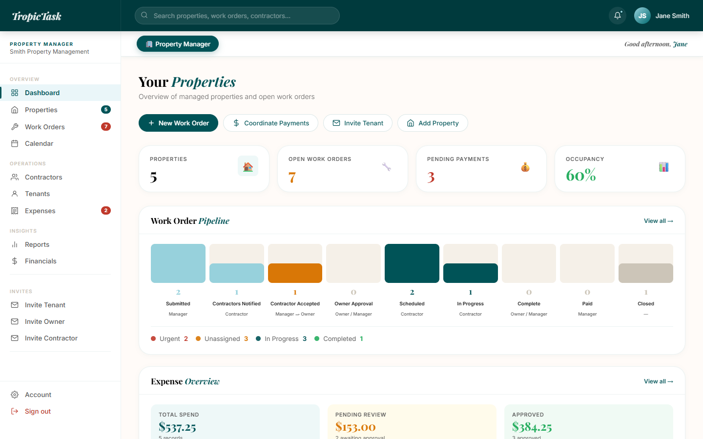

## What it does

**For property managers**
- A dashboard with properties, open work orders, pending payments and occupancy, a work
  order pipeline showing the count at each of the nine stages, and an expense overview
- Properties: a searchable list, add and edit, and a detail panel with the owner, rent,
  recent work orders, payments and tracked components (HVAC units, water heaters) with
  warranty status
- Work orders: create, assign a contractor, and advance stage by stage, sorted by stage
  and then priority (urgent, high, normal, low); Active and Closed tabs and a search box
- Payment requests (rent, deposit, maintenance, management fee, late fee, other), one-time
  or monthly, with pending, overdue and paid statuses
- Contractors with reviews and star ratings, tenants with their property, and a calendar of
  scheduled visits
- Expenses to approve, Reports (completion rate, urgent open, contractor performance, work
  orders by category) and Financials (collected, overdue, pending, spend and net cash)
- Invite flows for tenants, owners and contractors, and a global search across properties,
  work orders and people

**For owners**
- Their own properties, work orders, expenses, reports and financials, scoped to the
  properties they own; owner approval is stage 4 of every job

**For contractors**
- Available Jobs: unassigned jobs still in stages 1 to 2 plus their own; accept, mark on
  site, mark complete
- Log expenses against a job, paid by company card or personally, with an optional receipt;
  their reviews

**For tenants**
- Submit a maintenance request for their home, follow it through the stages, and see
  payments and shared documents

## How the work order lifecycle works

**Nine stages, one owner each.** `constants.js` defines the lifecycle once, and every
badge, pipeline bar and "Next action" button reads from it:

| Stage | Label | Who acts | Next action |
|---|---|---|---|
| 1 | Submitted | Manager | Send to Contractors |
| 2 | Contractors Notified | Contractor | Accept Job |
| 3 | Contractor Accepted | Manager, then Owner | Upload Quote & Notify Owner |
| 4 | Owner Approval | Owner / Manager | Approve Bid |
| 5 | Scheduled | Contractor | Mark On Site |
| 6 | In Progress | Contractor | Mark Complete |
| 7 | Complete | Owner / Manager | Confirm Payment |
| 8 | Paid | Manager | Close Work Order |
| 9 | Closed | none | none |

**Forward only, enforced twice.** In the app, advancing a job always moves it to
`stage + 1`, capped at 9, with a guard against double clicks. In the database,
`advance_wo_stage()` raises an error for any move that is not one step forward or a jump
straight to Closed. It stamps `completed_at`, `paid_at` and `closed_at` on stages 7, 8 and 9,
and writes each change, with who made it, to `wo_stage_history`.

**Numbers and roles in the schema.** A trigger assigns `WO-1000`, `WO-1001` and so on from
the highest existing number. Roles, priorities, categories, payment types and property
statuses are Postgres enums. A sign-up trigger (`handle_new_user`) creates the profile row,
and row-level security limits each role to its own rows. Migrations 006 and 007 rework those
policies into a simpler set.

**Local mode first.** With no Supabase keys, the whole app runs on a seed dataset kept in
`localStorage` (key `tt-app-v4`). Writes are debounced by 300ms so typing and uploads stay
responsive. Each action (create property, advance stage, approve expense) checks
`isSupabaseConfigured()` and calls the Supabase helper in `src/lib/supabase.js` when keys
are present, falling back to the local store otherwise. A realtime subscription on
`work_orders` is written and ready to use.

**Receipts.** Contractors attach a JPG, PNG, WebP, HEIC or PDF of up to 2MB. Larger files are
refused with the file's size in the message. The file is read with `FileReader` and stored
with the expense, which a manager then approves or sets back to pending.

## Stack

| Layer | Choice |
|---|---|
| Front end | React 18, Vite 5 |
| Styling | Hand-written CSS with brand tokens, Playfair Display and Inter |
| Backend (prepared) | Supabase: Postgres, Auth, row-level security, Realtime |
| Payments (prepared) | Stripe.js |
| Local mode | Seed data in `src/lib/seedData.js`, persisted to `localStorage` |
| Hosting | Netlify or Vercel (SPA rewrite configs for both) |

## Engineering

- 8 SQL migrations: 10 tables, 9 functions (including the RLS helpers such as
  `get_owned_property_ids`), 3 triggers, and the row-level security policies
- 16 views, all in one `App.jsx` sharing one React context
- Responsive from phone to desktop; on phones the sidebar becomes a slide-in menu
- `DEPLOYMENT.md` walks through Supabase, Stripe webhooks, Netlify and a custom domain
- No tests or CI in this repo

## Screenshots

| | |
|---|---|
| 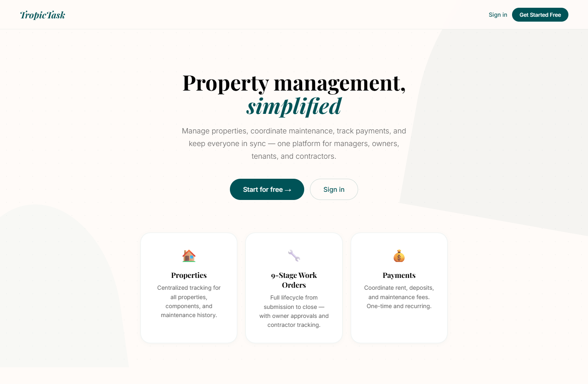 | 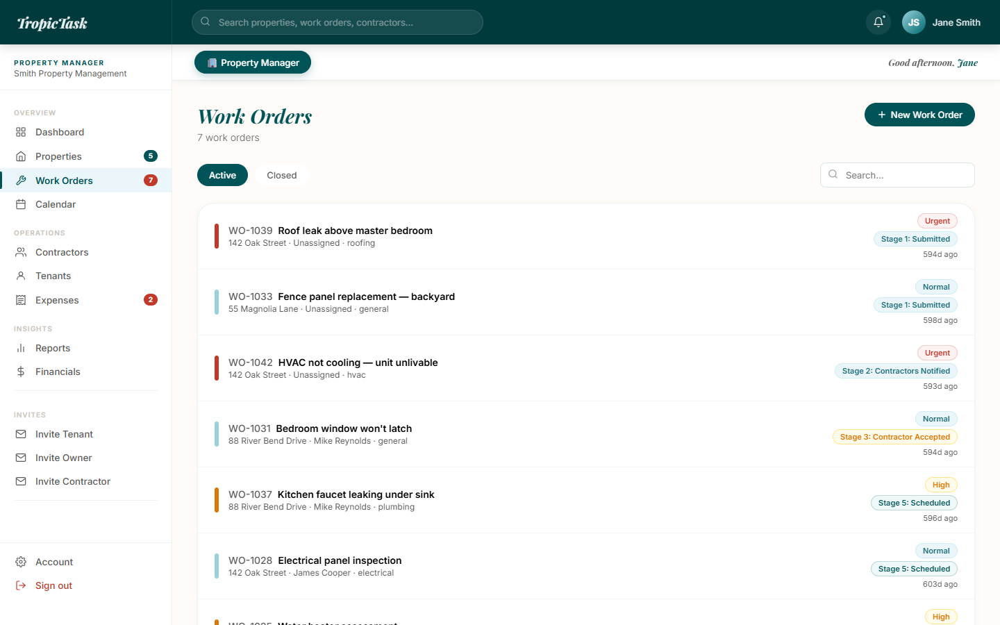 |
| Public landing page | Work orders, sorted by stage and priority |
| 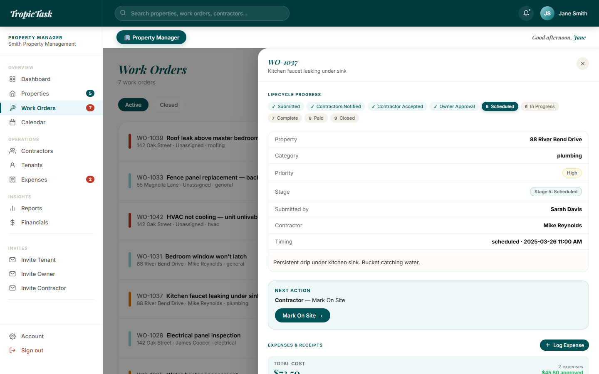 | 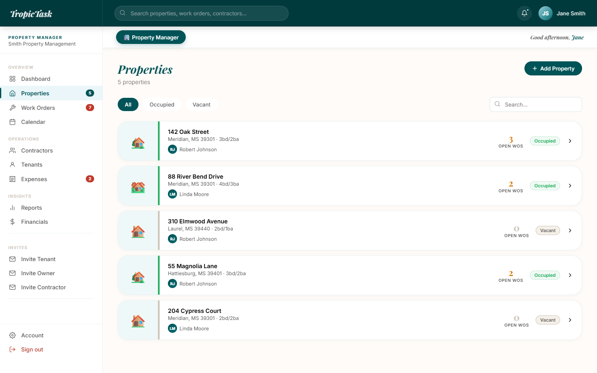 |
| A work order at stage 5 with its next action | Properties |
| 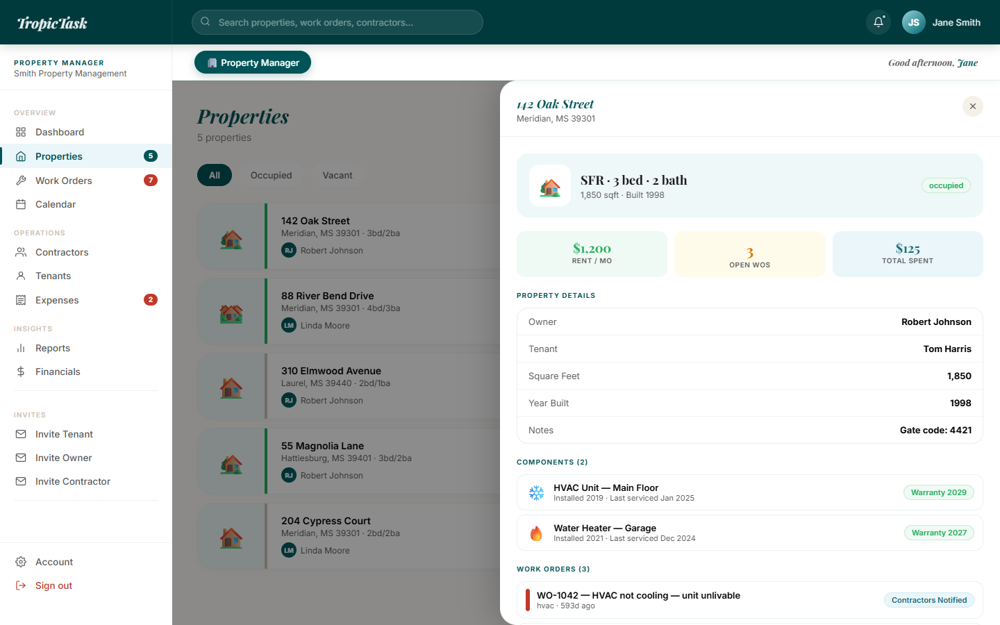 | 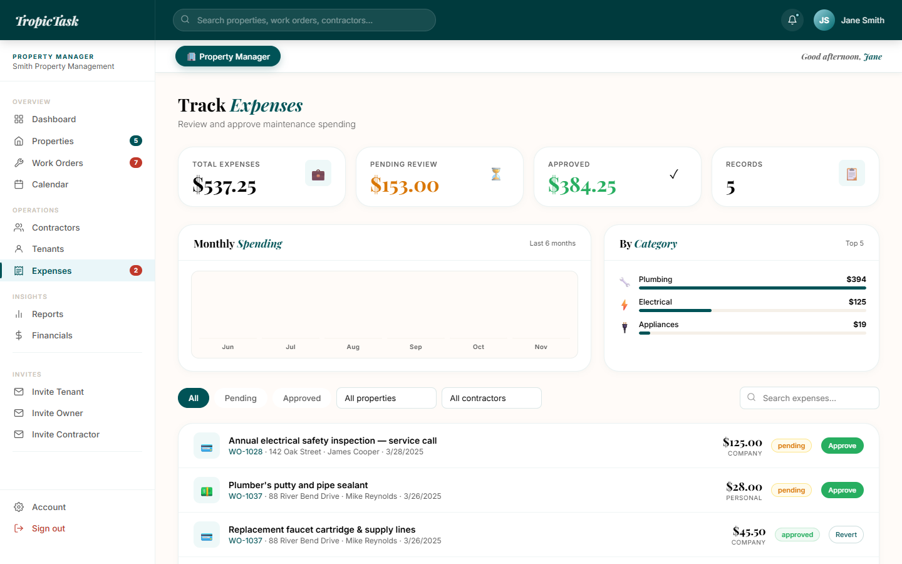 |
| Property detail panel | Expenses awaiting approval |
| 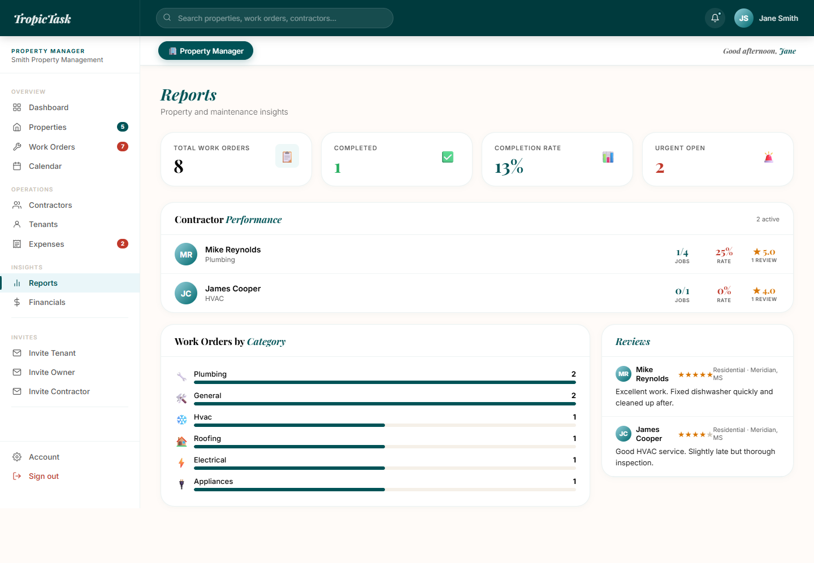 | 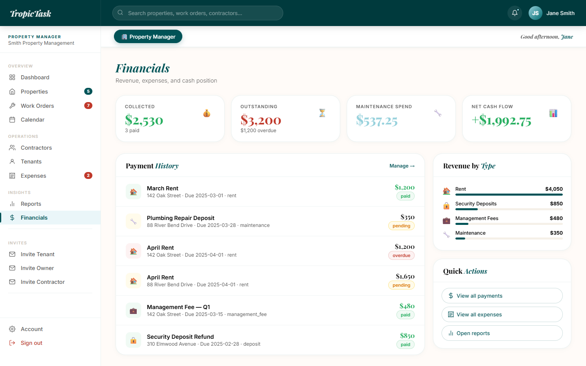 |
| Reports | Financials |
| 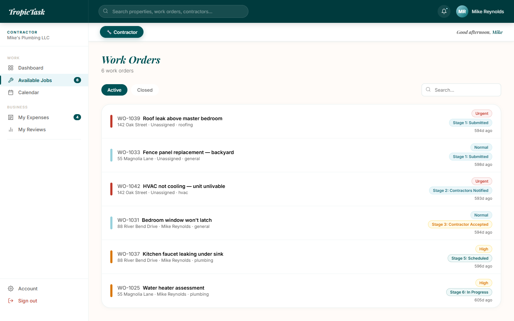 | 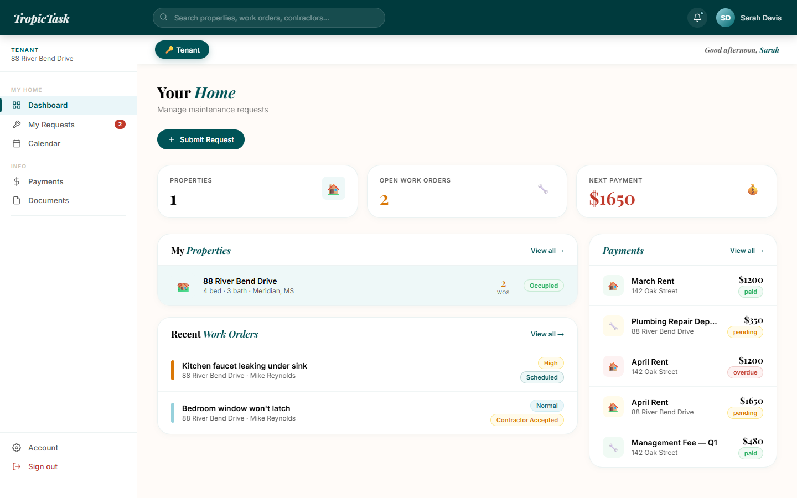 |
| A contractor's Available Jobs | A tenant's dashboard |
| 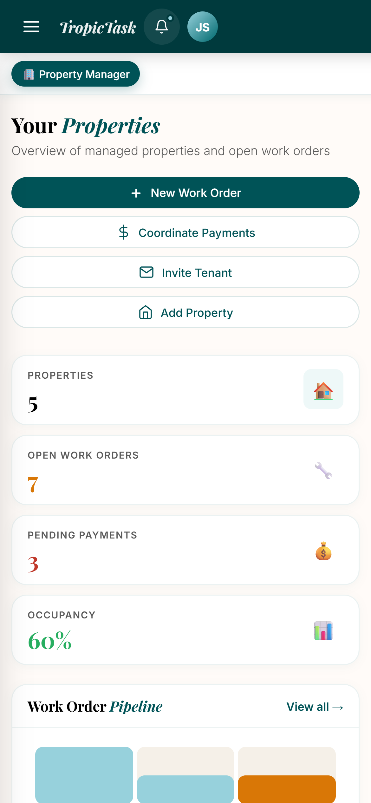 | |
| Manager dashboard on a phone | |

All screenshots show the app running locally in local mode with its built-in seed data. The
people, companies, addresses and amounts are fictional, and the phone numbers are 555
placeholders.

## Running it locally

```bash
git clone https://github.com/ashhhadd-210/tropictask-app.git
cd tropictask-app
npm install
npm run dev          # http://localhost:3000
```

With no `.env`, the app starts in local mode on the seed data. On the sign-in screen, pick
Manager, Owner, Contractor or Tenant under "demo accounts" to fill in a seeded login, then
sign in. To connect a backend, copy `.env.example` to `.env`, add your own Supabase URL and
anon key, and run the files in `supabase/migrations/` in order; `DEPLOYMENT.md` has the
full steps. `npm run build` writes the production bundle to `dist/`.

Confidential. TropicTask v1.0.
